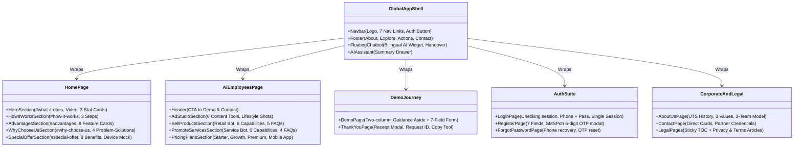

# Boss & Bots (BnB) Original Page Layout & Component Architecture

> **Reference Document:** [`bnb_business_context.md`](file:///d:/Projects/BossNBots/bnb_business_context.md)  
> **Source Website:** [https://bossnbots.com/](https://bossnbots.com/)  
> **Target Framework:** React / Vite Single Page Application (SPA), styled with Tailwind CSS  
> **Purpose:** Comprehensive structural reference detailing every page, section, component hierarchy, UI layout, and functional flow of the original Boss & Bots application.

---

## 1. System Architecture & Route Blueprint

The original Boss & Bots application runs as a client-side rendered Single Page Application (SPA). Global persistent shells wrap all public routes, while client authentication gates the dashboard and partner portals.

```
                                      ┌─────────────────────────────────┐
                                      │  Global Navigation & Floating   │
                                      │      Chatbot Widget Shell       │
                                      └────────────────┬────────────────┘
                                                       │
        ┌──────────────────────────────┬───────────────┴───────────────┬──────────────────────────────┐
        │                              │                               │                              │
┌───────▼────────┐             ┌───────▼────────┐              ┌───────▼────────┐             ┌───────▼────────┐
│  Landing Page  │             │  AI Employees  │              │  Demo Request  │             │   Auth Suite   │
│     ("/")      │             │("/ai-employees")              │   ("/demo")    │             │   ("/login")   │
└───────┬────────┘             └───────┬────────┘              └───────┬────────┘             └───────┬────────┘
        │                              │                               │                              │
        ├► #what-it-does               ├► Header Intro                 ├► Value Aside                 ├► /login
        ├► #how-it-works               ├► Ad Studio                    ├► Request Form                ├► /register
        ├► #advantages                 ├► Sell Products                └► Status Drawer               └► /forgot-password
        ├► #why-choose-us              ├► Promote Services                                            
        └► #special-offer              └► Pricing Table         ┌──────────────────────────────┬──────────────────────────────┐
                                                                │                              │                              │
                                                        ┌───────▼────────┐             ┌───────▼────────┐             ┌───────▼────────┐
                                                        │    About Us    │             │   Contact Us   │             │  Legal Pages   │
                                                        │  ("/about-us") │             │  ("/contact")  │             │("/privacy-...")│
                                                        └────────────────┘             └────────────────┘             └────────────────┘
```

### Route-to-Context Cross Reference Matrix

| Route Path | Component Name | Layout Type | Primary Business Function | Cross Reference in `bnb_business_context.md` |
|---|---|---|---|---|
| `/` | `HomePage` (`eK`) | Single-page continuous scroll with hash anchors | Product introduction, value props, social proof, CTA | Section 1, Section 2, Section 3 |
| `/ai-employees` | `AiEmployeesPage` (`sL`) | Multi-product catalog & pricing view | Deep-dive into AI products, capabilities, FAQs, pricing | Section 4, Section 5.A, Section 6 |
| `/demo`, `/demo-request` | `DemoPage` (`Ch`) | Two-column responsive split layout | Lead capture, trial scheduling, request tracking | Section 7 |
| `/thank-you` | `ThankYouPage` (`TU`) | Centered modal-style receipt page | Reference ID confirmation, follow-up explanation | Section 7 |
| `/about-us` | `AboutUsPage` (`PU`) | Informational corporate profile layout | Corporate pedigree, UTS Myanmar history, team model | Section 1, Section 7 |
| `/contact` | `ContactPage` (`zU`) | Two-column cards & address layout | Direct contact channels, partner banks, office location | Section 1 |
| `/login` | `LoginPage` (`FJ`) | Split-screen (Banner + Form card) | Existing user / admin / referrer credential sign-in | Section 8 |
| `/register` | `RegisterPage` (`TJ`) | Split-screen (Banner + Multi-field form) | New merchant registration with 2-step SMS OTP | Section 8 |
| `/forgot-password` | `ForgotPasswordPage` (`WJ`) | Split-screen (Banner + Phone OTP reset) | Password recovery via SMS verification | Section 8 |
| `/privacy-policy` | `PrivacyPolicyPage` (`OU`) | Two-column doc layout with sticky TOC | Legal privacy disclosure and data usage terms | Section 9 |
| `/terms-of-service`, `/terms`| `TermsOfServicePage` (`VU`) | Two-column doc layout with sticky TOC | Legal service agreement, disclaimers, acceptable use | Section 9 |

---

## 2. Global Persistent Layout Components

### 2.1 Sticky Navigation Bar (`Header / Navbar`)
- **Positioning:** Fixed / Sticky top (`sticky top-0 z-50 backdrop-blur-md bg-stone-50/90 border-b border-stone-200/60`).
- **Brand Element:** 
  - Left-aligned SVG logo: `bluish green no bg.svg` linking to `/`.
  - Brand typography: "Boss & Bots" with custom Fraunces / IBM Plex branding.
- **Desktop Navigation Links (`Yu` items):**
  1. `What it Does` (`/#what-it-does`) — Smooth scroll anchor.
  2. `How it Works` (`/#how-it-works`) — Smooth scroll anchor.
  3. `Advantages` (`/#advantages`) — Smooth scroll anchor.
  4. `Why Choose Us` (`/#why-choose-us`) — Smooth scroll anchor.
  5. `Special Offer` (`/#special-offer`) — Smooth scroll anchor.
  6. `AI Employees` (`/ai-employees`) — Page transition link.
  7. `Contact Us` (`/contact`) — Page transition link.
- **Scrollspy Behavior:** Active link state dynamically switches based on window scroll offset (140px threshold) across section IDs (`NF`).
- **Primary Action (CTA):**
  - Dynamic Auth Button:
    - If unauthenticated: Displays `Login` (`/login`).
    - If user authenticated: Displays `Dashboard` (`/dashboard`).
    - If referrer authenticated: Displays `Dashboard` (`/referrer`).
    - If admin authenticated: Displays `Dashboard` (`/admin`).
- **Mobile Drawer:** Hamburger button (`Open menu`) triggering an off-canvas navigation sheet on `< lg` viewports.

---

### 2.2 Global Footer (`contentinfo`)
- **Visual Style:** Muted dark/stone tone container with subtle border separators.
- **Top Brand Block:**
  - Logo & Brand Title: `Boss & Bots`.
  - Tagline: *"The boss runs the business. Bots handle the work."*
  - Mission Paragraph: *"ကျွန်ုပ်တို့သည် နည်းပညာကိုသာ ရောင်းချခြင်းမဟုတ်ပါ။ မြန်မာလုပ်ငန်းရှင်များ အချိန်ကုန်သက်သာပြီး အရောင်းအခွင့်အလမ်းများကို အကောင်းဆုံး အသုံးချနိုင်မည့် Digital Ecosystem တစ်ခုကို တည်ဆောက်ပေးခြင်း ဖြစ်ပါသည်။"*
  - Attribution: *"Powered by UTS Myanmar"*.
- **Navigation Columns (4-Column Grid on Desktop):**
  1. **Column 1 - EXPLORE:**
     - `Why Choose Us` (`/#why-choose-us`)
     - `How It Works` (`/#how-it-works`)
     - `Advantages` (`/#advantages`)
     - `Privacy Policy` (`/privacy-policy`)
     - `Terms of Service` (`/terms-of-service`)
     - `About Us` (`/about-us`)
  2. **Column 2 - TAKE ACTION:**
     - `Request Demo` (`/demo`)
     - `Contact Us` (`/contact`)
     - `AI Employees` (`/ai-employees`)
  3. **Column 3 - CONTACT DETAILS (`ဆက်သွယ်ရန်အချက်အလက်`):**
     - Email: `admin@utsmyanmar.com`
     - Phone: `09442508508 / 09442509509`
     - Address: `Floor 8, No.(28), Coner of Bogyoke Road and Botahtaung Pagoda Road. Yangon Myanmar`
     - Direct CTA: `Demo Request` (`/demo`)
- **Bottom Bar:**
  - Copyright statement: `© 2026 Boss & Bots. All rights reserved.`
  - Policy links: `Privacy Policy`, `Terms of Service`, `Contact`.

---

### 2.3 Floating AI Live Chatbot & Assistant Launcher
- **Positioning:** Fixed floating container in bottom-right corner (`fixed bottom-5 right-5 z-[9999]`).
- **Trigger Elements:**
  - Launcher pill with notification badge: *"AI LIVE CHATBOT ဒီမှာမေးပါ မင်္ဂလာပါ။ ဒီနေရာမှာ သိလိုသည့် အကြောင်းအရာများကို လွတ်လပ်စွာမေးမြန်းနိုင်ပါတယ်။"*
  - Tooltip bubble: *"Chat with Boss & Bots"*.
  - AI Assistant Side-Button: *"Get summaries and key insights using AI Assistant"*.
- **Expanded Chat Window Structure:**
  1. **Chat Header:**
     - Title: `CHATBOT`
     - Status subtitle: `Chatbot မှဖြေကြားပေးနေပါတယ်။`
     - Human Handover Pill (`button`): `လူနှင့်စကားပြောမည်` (Requests staff takeover).
     - Action icons: `Clear chat history` (resets session) and `Close chat`.
  2. **Message Stream:**
     - Greeting message bubble: *"မင်္ဂလာပါ။ ကျွန်တော်က Boss & Bots ရဲ့ chatbot ဖြစ်ပါတယ်။ မြန်မာဘာသာနဲ့ဖြစ်ဖြစ် English နဲ့ဖြစ်ဖြစ် မေးနိုင်ပါတယ်။"*
  3. **Quick Suggestion Chips (Prompt Pills):**
     - `မြန်မာလို မေးလို့ရမလား?`
     - `What are your pricing plans?`
     - `Demo booking ဘယ်လိုလုပ်ရမလဲ?`
     - `What services do you offer?`
  4. **Input Area:**
     - Text field with placeholder: *"Ask here in Myanmar language or English"*
     - Send button with arrow icon.

---

## 3. Detailed Page Layouts & Sectional Breakdown

### 3.1 Landing Page (`/` - `HomePage`)

#### Section 3.1.1: Hero Section (`#what-it-does`)
- **Layout:** Asymmetric 2-column grid (`lg:grid-cols-[minmax(0,3fr)_minmax(0,2fr)] items-stretch`).
- **Left Column (Text & Value Pitch):**
  - **H1 Headline:** `Boss & ` `<span class="text-teal-700">Bots</span>` ` ဆိုတာဘာလဲ ?`
  - **Intro Paragraph 1:** Details 24/7 digital workers for online shops and SMEs, handling Telegram and Facebook Messenger enquiries.
  - **Intro Paragraph 2:** Explains the business automation workflow giving owners complete control.
  - **Primary CTA Button:** `Request Demo` (`/demo`) with hover translate animation (`hover:-translate-y-0.5`).
  - **3 Hero Metric Cards (`pF` array):**
    1. *24/7 Response Coverage* — Value: `24 hours` | Subtitle: Uninterrupted customer response.
    2. *Connected Channels* — Value: `2+` | Subtitle: Telegram and Facebook Messenger in one place.
    3. *Owner Control* — Value: `Boss Control` | Subtitle: Ticket Raising System for critical escalation.
- **Right Column (Visual / Video Demo Media):**
  - Video player rendering product demo animation: `/BNB%20-%2001.mp4`.
  - Custom audio toggle control and progress indicator overlay.

---

#### Section 3.1.2: How It Works (`#how-it-works`)
- **Layout:** Centered header followed by a vertical 3-step alternating or stacked cards section.
- **Header:**
  - Section Title: `Boss & Bots အလုပ်လုပ်ပုံ`
  - Subtitle: `Boss တစ်ယောက်အနေနဲ့ နည်းပညာပိုင်း နက်နက်နဲနဲ သိစရာမလိုဘဲ အဆင့် ၃ ဆင့်နဲ့ စတင်နိုင်ပါသည်`
- **Step Cards:**
  1. **STEP 01: Data Import & Training**
     - Graphic: `step1_data_import.png`
     - Description: Upload product list, teach SOP and conversational style.
     - Sub-bullets: Smart Product Registration, Bulk CSV/Excel Data Import.
  2. **STEP 02: Channel Integration**
     - Graphic: `step2_channel_integration.png`
     - Description: One-click integration with Telegram and Facebook Messenger.
     - Sub-bullets: Ticket Raising System, Automated Order Handling System.
  3. **STEP 03: Manage & Monitor**
     - Graphic: `step3_manage_monitor.png`
     - Description: Centralized management dashboard for conversation logs, sales, and daily performance.
     - Sub-bullets: Live AI monitoring, direct chat takeover, stock and sales tracking.

---

#### Section 3.1.3: Core Advantages Grid (`#advantages`)
- **Layout:** Section header with a responsive 2x4 (8-card) feature grid (`grid sm:grid-cols-2 lg:grid-cols-4 gap-4`).
- **Header:**
  - Section Title: `Boss & Bots ရဲ့ အားသာချက်များ`
  - Subtitle: Business automation features that consolidate inquiries, orders, support, and reports.
- **Card Items:**
  1. *Smart Product Registration:* Catalog setup with photos, prices, specifications.
  2. *Inventory Import & Export:* Bulk Excel import for hundreds of products.
  3. *Inventory Analysis:* Sales logs export for simplified bookkeeping.
  4. *AI-Employee:* Structured bot training matched to shop sales style.
  5. *Order Management:* Precise inventory checks and price quoting.
  6. *Copywriting Management:* Reporting on daily inquiry volume and sales metrics.
  7. *Support-Ticketing System:* Automatic notification and chat handover for unresolved queries.
  8. *Management Dashboard:* Unified dashboard monitoring real-time performance.

---

#### Section 3.1.4: Why Choose Us (`#why-choose-us`)
- **Layout:** Split layout featuring comparison cards on the left/center and a thematic illustration on the right (`chatbot_illustration.png`).
- **Header:**
  - Section Title: `Boss & Bots ကို ဘာကြောင့် ရွေးချယ်သင့်တာလဲ ?`
  - Subtitle: Practical solutions for daily operational headaches encountered by Myanmar online shops.
- **Comparison Stack (4 Problem-Solution Cards):**
  - Card 1: High employee turnover drops sales ➔ AI preserves SOP & product knowledge.
  - Card 2: Constant re-training of new hires ➔ One-time bot setup, repeatable sales workflow.
  - Card 3: Delayed replies lose deals ➔ 24/7 instant replies capture day/night leads.
  - Card 4: Incorrect price/stock quotes ➔ Connected live inventory and pricing eliminate mistakes.

---

#### Section 3.1.5: Special Offer & Business Benefits (`#special-offer`)
- **Layout:** High-contrast offer banner with background treatment, benefit list, and device mockup image (`demo-digital-device.jpg`).
- **Header Block:**
  - Title: `လုပ်ငန်းရှင်များ အတွက် အထူးကမ်းလှမ်းချက်`
  - Kicker / Badge: `ငွေစိုက်မထုတ်ခင်အရင်ကြည့်ပါ။` (Try before paying).
  - Pitch: Explains the bundled Free Consulting Service alongside the software demo.
  - Limited Availability Notice: *"တစ်ပတ်လျှင် လုပ်ငန်း ၅ ခုသာ အခမဲ့ consulting ပေးနိုင်ပါသည်"* (Limited to 5 businesses per week).
  - Main CTA: `Request Demo + Consulting` (`/demo`).
- **Benefits Checklist (8 Key Items):**
  1. Systematic business operations freeing up owner leisure time.
  2. Elimination of employee hiring, turnover, and retraining stress.
  3. Unified management of social media inquiry streams.
  4. Rapid generation of compelling customer ad copy.
  5. Tracking revenue drop-offs and sales performance causes.
  6. Real-time monitoring of product velocity, prices, and demand.
  7. Product and operational insights mined from customer FAQs.
  8. Full supervisory control over business cash flow.

---

### 3.2 AI Employees & Solutions Page (`/ai-employees` - `AiEmployeesPage`)

#### Section 3.2.1: Page Header & Hero
- **Header Elements:**
  - Kicker: `Boss & Bots`
  - Heading: `AI Employees for Your Business`
  - Subtitle: Tailored AI solutions for SMEs to answer queries, capture orders, and create promotional content.
  - Action Buttons: `Request a Demo` (`/demo-request`) and `Contact Us` (`/contact`).

---

#### Section 3.2.2: Ad Studio Showcase
- **Product Title:** `Ad Studio`
- **Sub-badge:** `AI Content Creation Tool`
- **Narrative Content:**
  - Explains why Ad Studio outperforms manual ChatGPT prompt engineering by using pre-saved brand info, product details, customer segments, and brand tone.
- **Features Grid (6 Deliverable Cards):**
  1. *Ad Headlines:* Punchy marketing titles.
  2. *Social Media Captions:* Brand-aligned captions for Facebook and Instagram.
  3. *Promotion Content:* Fast creation of campaign materials.
  4. *Ad Copy:* Full advertising text based on product specs.
  5. *Studio Style Images:* AI studio enhancement from plain product photos.
  6. *Product Lifestyle Shots:* Realistic lifestyle backgrounds for product showcasing.
- **Guidelines & Billing:**
  - Beginner-friendly interface requiring minimal inputs.
  - Points-based credit system.
  - Editorial review notice: Merchants should verify pricing and dates before publishing.
- **Direct CTA:** `Try Ad Studio` (`/login`).

---

#### Section 3.2.3: AI Employee for Sell Products (Retail / Online Shops)
- **Product Title:** `AI Employee for Sell Products` (`Sell Products`)
- **Target Audience:** Online shops, retail stores, clothing boutiques, shoes, cosmetics, minimarts, bookstores.
- **6 Core Capabilities:**
  1. *Customer Enquiry ဖြေပေးခြင်း (Inquiry Handling)*
  2. *Product Recommendation (Smart Upselling)*
  3. *Order စုဆောင်းပေးခြင်း (Order Information Gathering)*
  4. *Sales Conversation Flow (Structured Dialogue)*
  5. *Human Takeover (Intervention on Demand)*
  6. *24/7 ဝန်ဆောင်မှု (Round-the-clock Availability)*
- **Implementation Sequence (How It Works):**
  - Step 1: Input Product Data, Stock, Delivery & Payment policies.
  - Step 2: Establish FAQs, reply tone, order workflow SOPs.
  - Step 3: Boss & Bots team conducts setup and staff training.
- **Accordion FAQs (5 Items):**
  - FAQ 1: Can the AI recommend products based on budget/specs?
  - FAQ 2: Can the AI accept orders automatically without owner confirmation?
  - FAQ 3: Which messaging channels are supported?
  - FAQ 4: Does the AI answer with 100% accuracy?
  - FAQ 5: Does the AI support Burmese language and mixed colloquial terms?

---

#### Section 3.2.4: AI Employee for Promote Services (Service SMEs)
- **Product Title:** `AI Employee for Promote Services` (`Promote Services`)
- **Target Audience:** Salons, spas, academies, real estate agencies, auto showrooms, clinics, consultants.
- **6 Core Capabilities:**
  1. *Service Enquiry ဖြေပေးခြင်း (Package & Process Details)*
  2. *Booking စုဆောင်းပေးခြင်း (Appointment Info Collection)*
  3. *Customer Qualification (Need Assessment)*
  4. *FAQ Auto-Reply (Reduces repetitive front-desk workload)*
  5. *Human Handover (Escalation to specialized staff)*
  6. *Dashboard စီမံခန့်ခွဲမှု (Unified conversation and booking logs)*
- **Accordion FAQs (4 Items):**
  - FAQ 1: Is this suitable for my specific service business?
  - FAQ 2: Can the AI mirror our company's unique brand tone?
  - FAQ 3: How long does onboarding and setup take?
  - FAQ 4: Does the AI replace our human employees?

---

#### Section 3.2.5: Pricing Plans Comparison Table
- **Header:** `Pricing Plans` | `လုပ်ငန်းလိုအပ်ချက်အလိုက် Plan ရွေးချယ်နိုင်ပါတယ်`
- **Card Matrix (3 Tiers):**
  1. **Starter Plan (Basic Plan):**
     - Price: `200,000 MMK / month`
     - Features: 1 User Admin, No Multi-users, 1 Inventory DB, 1 Shop, Unlimited Social Channels.
  2. **Growth Plan (Standard Plan) [Badge: Popular]:**
     - Price: `400,000 MMK / month`
     - Features: Unlimited Admins, Unlimited Multi-users, 1 Inventory DB, Unlimited Shops, Unlimited Social Channels.
  3. **Premium Plan [Badge: Best Value]:**
     - Price: `700,000 MMK / month`
     - Features: Unlimited Admins, Unlimited Multi-users, Unlimited Inventory DBs, Unlimited Shops, Unlimited Social Channels.
- **Add-on Banner:**
  - `E-commerce Mobile App (iOS & Android)` — `+200,000 MMK / month` extra.
- **Bottom Callout:** Notice that initial consultation helps determine the ideal plan, with CTA: `Book a Free Demo` (`/demo-request`).

---

### 3.3 Demo Request Page (`/demo` & `/demo-request` - `DemoPage`)

#### Layout Architecture
A clean two-column grid (`max-w-6xl lg:grid-cols-[0.92fr_1.08fr] gap-8 md:py-12`):

```
┌────────────────────────────────────────┬────────────────────────────────────────┐
│  Left Column: Value Pitch & History   │   Right Column: Demo Request Form      │
├────────────────────────────────────────┼────────────────────────────────────────┤
│ • Kicker: Boss & Bots · Demo Request   │ • Header: Your details (~1 minute)     │
│ • Heading: Demo အတွက် business details │ • Field: Business Name *               │
│ • Sub: Consultant contact in 24 hours  │ • Field: Contact Person Name           │
│ • Benefit 1: 24h Consultant Call       │ • Field: Email (Optional)              │
│ • Benefit 2: Custom Sample Data Test   │ • Field: Phone Number * (+95 9...)     │
│ • Info Note: Journey Tracking Notice   │ • Field: Business Category             │
│ • History Drawer: Status of past reqs  │ • Field: Product / Service Examples    │
│                                        │ • Field: Additional Notes / Volumes    │
│                                        │ • Button: ရက်ချိန်းရယူမည် (Submit)      │
└────────────────────────────────────────┴────────────────────────────────────────┘
```

#### Form Controls Breakdown
- `demo-business-name`: Text input (`လုပ်ငန်းအမည်*`, placeholder: *ဥပမာ - Boss Fashion House*).
- `demo-contact-name`: Text input (`ဆက်သွယ်ရန်အမည်`, placeholder: *ဥပမာ - U Mg Mg*).
- `demo-email`: Email input (`အီးမေးလ်`, placeholder: *email*, helper: *မဖြစ်မနေ ထည့်ရန်မလိုအပ်ပါ*).
- `demo-phone`: Phone input (`ဆက်သွယ်ရန် ဖုန်းနံပါတ်*`, placeholder: *+95 9 XXX XXX XXX*).
- `demo-business-type`: Text input (`လုပ်ငန်းအမျိုးအစား`, placeholder: *ဥပမာ - Online Shop, Beauty Salon*).
- `demo-product-examples`: Text input (`ပစ္စည်း / ဝန်ဆောင်မှု ဥပမာ`, placeholder: *ဥပမာ - Korean Dress, Spa packages*).
- `demo-notes`: Textarea (`ထပ်မံသိစေချင်သော အချက်အလက်များ`, placeholder: *Chat volume, လက်ရှိ channel များ, team setup စတာတွေကို ထပ်ဖြည့်နိုင်ပါသည်။*).
- Submit Button: `ရက်ချိန်းရယူမည်` (shows `ပေးပို့နေသည်...` during submission).

---

### 3.4 Demo Confirmation Page (`/thank-you` - `ThankYouPage`)
- **Layout:** Centered card with success styling.
- **Components:**
  - Status Indicator: Checkmark badge.
  - Headline: `Demo / Consulting တောင်းဆိုမှုကို လက်ခံရရှိပါသည်`.
  - Body Text: Confirms business consultant outreach within 24 hours, preparation of sample product data, chat flow, and owner requirements.
  - **Request ID Card:** Displays generated `requestId` with one-click `Copy ID` button.
  - Guidance Note: Explains how to use the Request ID to track status in the demo history panel.
  - Action Group:
    - `ပင်မစာမျက်နှာသို့ ပြန်သွားမည်` (Back to Home -> `/`)
    - `Demo Request History` (`/demo`)
    - `Contact Team` (`/contact`)

---

### 3.5 About Us Page (`/about-us` - `AboutUsPage`)

#### Section 3.5.1: Hero & UTS Myanmar Profile
- **Title:** `Boss & Bots ရဲ့ နောက်ကွယ်မှာ UTS Myanmar ရဲ့ business-grade digital delivery experience ရှိပါတယ်`
- **Corporate Narrative:**
  - Details U-Tech Solutions' founding in 2017.
  - Lists domestic banking clients: CB Bank, KBZ Bank, A Bank, Yoma Bank, UAB Bank.
  - Lists global tech partners: DZ Card, Finexus, Sunmi, Castles Technology, Securemetric.
  - Explains the transition from enterprise banking fintech to empowering Myanmar SME online shops.

#### Section 3.5.2: Three Core Company Values
1. **လုပ်ငန်းရှင်ဗဟိုပြုခြင်း (Merchant Centricity):** Building exclusively for business owner productivity.
2. **စဉ်ဆက်မပြတ် တိုးတက်နေခြင်း (Continuous AI Evolution):** Keeping AI employee models updated with state-of-the-art tech.
3. **နွေးထွေးသော ဝန်ဆောင်မှု (Human-Led Warmth):** Human technical support backing the automated AI system.

#### Section 3.5.3: The Team Behind Boss & Bots (Three-Team Delivery Model)
- **Header:** `The Team Behind Boss & Bots` | Professional three-team delivery model ensuring merchant confidence.
- **3 Team Columns:**
  1. **Unit 01: The Visionaries (Product Team)**
     - Role: Research merchant friction and design intuitive automation features.
     - Owner Benefit: Merchants always receive competitive, cutting-edge sales tools.
  2. **Unit 02: The Architects (Tech Team)**
     - Role: Maintain 24/7 high-availability infrastructure and secure merchant data.
     - Owner Benefit: Zero-downtime customer conversations and enterprise-grade data privacy.
  3. **Unit 03: The Supporters (Customer Success Team)**
     - Role: Train AI employees on specific shop SOPs and provide hands-on setup support.
     - Owner Benefit: Non-technical merchants gain dedicated partners to ensure measurable sales growth.

---

### 3.6 Contact Us Page (`/contact` - `ContactPage`)
- **Title:** `ဆက်သွယ်ရန်`
- **Introductory Copy:** Explains direct consultation channels with UTS Myanmar business and tech teams.
- **Information Blocks:**
  - **Email:** `admin@utsmyanmar.com`
  - **Phone Numbers:** `09442508508` / `09442509509`
  - **Physical Address:** `Floor 8, No.(28), Coner of Bogyoke Road and Botahtaung Pagoda Road. Yangon Myanmar`
  - **Business Consultation SLA:** Consultant response within 24 hours.
  - **Corporate Backing:** Reiterates UTS Myanmar corporate credentials and partner ecosystem.

---

### 3.7 Authentication Suite (`/login`, `/register`, `/forgot-password`)

#### Unified Split-Screen Layout Structure
All authentication views share an asymmetric two-pane layout (`min-h-screen grid lg:grid-cols-2`):
- **Left Pane (Marketing Promo Panel):** Features high-contrast dark/amber background with promotional copy for Ad Studio and product imagery tools.
- **Right Pane (Form Card):** Contains the actual interactive auth inputs.

```
┌────────────────────────────────────────┬────────────────────────────────────────┐
│     Left Panel: Marketing Pitch        │       Right Panel: Form Card           │
├────────────────────────────────────────┼────────────────────────────────────────┤
│ • Graphic illustration / badge         │ • Auth Kicker & Subtitle               │
│ • Title: "Create ads without prompt    │ • Input Field 1 (Phone Number)         │
│   grind" / "Get started with Ad Studio"│ • Input Field 2 (Password)             │
│ • Bullet points of Ad Studio benefits  │ • Forgot password link                 │
│ • Single session policy notice         │ • Primary Action Submit Button         │
│                                        │ • Alternate Route Navigation link      │
└────────────────────────────────────────┴────────────────────────────────────────┘
```

#### View 3.7.1: Sign In (`/login` - `LoginPage`)
- **Marketing Copy:** Focuses on signing in to Ad Studio without prompt engineering.
- **Session Check Loader:** Displays full-card spinner with `"Checking your session..."`.
- **Form Fields:**
  - Phone Number (`09xxxxxxxxx`)
  - Password (`Enter your password`)
  - Helper Link: `Forgot password?` (`/forgot-password`)
  - Submit Button: `Sign in` (toggles to `Signing in...`)
  - Redirect Link: `Don't have an account? Register` (`/register`)
- **Error Handling States:**
  - `session_conflict`: *"This account is already logged in on another device. Please log out there first."*
  - `invalid_credentials`: *"That phone number or password is not correct."*
  - `phone_not_verified`: *"This phone is not verified yet. Please register with a code first."*

---

#### View 3.7.2: Register (`/register` - `RegisterPage`)
- **Marketing Copy:** Focuses on Ad Studio account onboarding.
- **Form Fields (Step 1 - Account Information):**
  - Business Name (`လုပ်ငန်းအမည်`)
  - Your Name (`ပိုင်ရှင်အမည်`)
  - Phone Number (`ဖုန်းနံပါတ်` - Myanmar mobile)
  - Email (`အီးမေးလ်`)
  - Password (`စကားဝှက်` - minimum 8 characters)
  - Social Media Link (`လူမှုကွန်ရက်လင့်ခ်` - Facebook, Telegram, TikTok, Instagram)
  - Referral Code (`Referral code` - optional)
  - Checkbox: Agreement to Privacy Policy and Terms of Service.
- **Step 2 - Two-Step SMS OTP Verification Modal:**
  - Provider: SMSPoh.
  - Input: 6-digit verification code.
  - Timer: 180-second expiration countdown; 30-second resend cooldown.
  - Error messages:
    - `carrier_not_supported`: *"OTP is not available for Mytel SIMs yet. Try Atom, Ooredoo, or MPT."*
    - `phone_taken`: *"An account already exists with this phone number."*
    - `otp_service_unavailable`: *"SMS verification is temporarily unavailable."*

---

#### View 3.7.3: Forgot Password (`/forgot-password` - `ForgotPasswordPage`)
- **Marketing Copy:** *"Reset access in a few texts"* — explains how both user and referrer accounts can recover passwords via their phone number.
- **Two-Step Recovery Flow:**
  1. Phone input form ➔ sends 6-digit SMS OTP.
  2. OTP entry + New Password + Confirm New Password ➔ commits reset and terminates prior active sessions.

---

### 3.8 Legal Documentation Pages (`/privacy-policy`, `/terms-of-service`)

#### Layout Architecture
- Two-column documentation layout (`grid lg:grid-cols-[220px_minmax(0,1fr)] gap-6 items-start`):
  - **Left Sidebar:** Sticky Table-of-Contents navigation (`hidden lg:block lg:sticky lg:top-24`) highlighting sections on scroll.
  - **Right Main Content:** Structured article with numbered sections, legal headings, and text blocks.

#### Content Structure
- **Privacy Policy (`/privacy-policy`):**
  - Last updated: `29 August 2026`.
  - Operator: UTS Myanmar.
  - Sections: 01 Who we are, 02 Information we collect, 03 How we use information, 04 Third-party sharing (SMSPoh, AI models, Telegram/Messenger APIs), 05 Retention, 06 Security, 07 User rights.
- **Terms of Service (`/terms-of-service`):**
  - Last updated: `29 August 2026`.
  - Sections: 01 Agreement & Business Representation, 02 Accounts & Phone OTP rules, 03 Services Provided, 04 Points & Payments (No stored-value wallet disclaimer, screenshot upload rules), 05 AI Content Accuracy Disclaimer, 06 Acceptable Use, 07 Referrals & Commissions, 08 Intellectual Property.

---

## 4. UI/UX Critique & Onboarding Friction Mapping

In reference to [`Project Requirement Document_.md`](file:///d:/Projects/BossNBots/Project%20Requirement%20Document_.md) and the extracted layout above, here is the concrete mapping of original layout flaws to the required revamp:

| Original UI / UX Implementation | Concrete Failure in Current Codebase | Target Solution in New Onboarding App |
|---|---|---|
| **Session Checking Delay** | Both `/login` and `/register` mount a blocking `<Checking your session...>` spinner that stalls user interaction while waiting for backend auth round-trips. | Replace with optimistic client rendering, fast token caching, and instant SSO options. |
| **Mandatory Upfront SMS OTP** | Registration immediately triggers SMS OTP verification before the merchant ever sees the dashboard or experiences bot value. High carrier drop-off (e.g. Mytel unsupported). | Defer phone & SMS verification; provide immediate interactive onboarding, fast OAuth2/SSO, and let users explore their business setup before requiring phone verification. |
| **Dim & Moody Aesthetics** | The split auth panels use heavy slate/stone and grim contrast tones (`bg-stone-50`, dark aside cards) that feel uninviting for retail merchants. | Create an energetic, highly visual, animated onboarding walkthrough tailored to Myanmar SME merchants. |
| **Scattered Value Exploration** | In the original layout, Ad Studio, Sell Products bot, and Service bot are separated across text-heavy pages with static forms. | Unify the value discovery directly within the new onboarding session, letting merchants select their business type (Retail vs. Service) interactively. |

---

## 5. Summary Diagram of Page-to-Component Mapping


